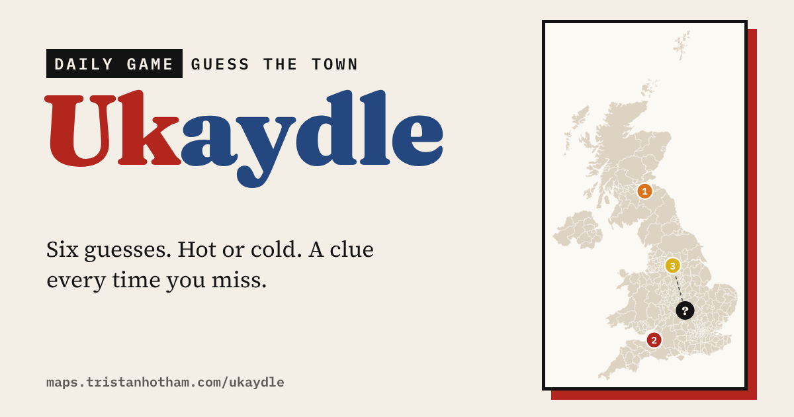

# Ukaydle

A daily map game: guess the mystery UK town in six goes. **[Play it](https://maps.tristanhotham.com/ukaydle/)**

## How it works

- Type a town and pick it from the list. Each guess shows how far away the mystery town is, which way to go, and how close you are (0% at 1,000 km, 100% when you get it).
- Every wrong guess unlocks a clue: its size; its sunshine and rain; house prices (or pay) and the Leave vote in its council area; the oddest thing about its council area; its county or council; and finally its first letter.
- Get it right, or run out of guesses, and the town appears on the map with what its name means, a shareable grid of coloured squares and arrows, and your stats.
- **Today's town** is the same for everyone each day. **Practice** gives you a random town whenever you like.

Daily towns are drawn from about 240 UK cities and towns of 40,000 people or more; Practice uses about 560 towns of 15,000 or more. You can guess any of about 3,000 towns. London's boroughs are left out as answers.

## Files

- `index.html`: the game (one page, no build step)
- `towns.json`: answer towns with their clues and name meanings, the list of guessable towns, and area labels
- `map.json`: simplified council boundaries and the map projection
- `build.py.txt`: the script that builds `towns.json` (Python; uses data from my Higher or Lower game and earlier studies)

## Sources and licence

Towns: OS Open Names and GeoNames, via my [Sun and Rain](https://maps.tristanhotham.com/sun-and-rain-uk/) study, and ONS built-up areas (2022) for populations, via my [post box](https://maps.tristanhotham.com/postbox-kings/) study. Weather: Met Office HadUK-Grid 1991–2020 averages. Council clues: the 66 measures in [Higher or Lower](https://github.com/Tristan-Hotham/higher-or-lower) (ONS, Nomis, Electoral Commission, Met Office and counts from my own studies). Council boundaries: ONS. Contains public sector information licensed under the Open Government Licence v3.0; contains OS data © Crown copyright and database right 2026; GeoNames (CC BY 4.0).

Name meanings are the usual explanations of common place-name elements; many names have more than one theory.

Code: MIT. Derived data: CC BY 4.0, keeping the attributions above.

Dr Tristan Hotham, independent researcher · 2026 · [tristanhotham.com](https://tristanhotham.com)

AI use: built with coding and drafting help from Claude (Anthropic). I reviewed and checked the data and text.
